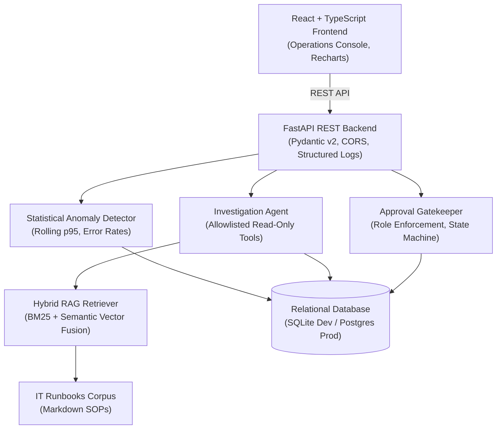

# SentinelOps AI
### AI-Powered Enterprise IT Operations & Incident Response Platform


SentinelOps AI is a full-stack, simulated enterprise IT operations and incident response platform. It demonstrates automated telemetry correlation, hybrid retrieval-augmented generation (RAG) over IT runbooks, deterministic root-cause diagnosis, and approval-controlled remediation.

Built as an engineering portfolio project, SentinelOps AI emphasizes **explainability, grounded evidence citations, defense-in-depth safety gates, and zero-dependency local operation**.

---

## 1. Problem Statement

During major microservice outages, on-call IT operations and SRE teams are inundated with disconnected telemetry: thousands of error logs, spiking latency metrics, unlinked deployments, and buried wiki runbooks.

Triaging incidents manually leads to:
- **Prolonged MTTR (Mean Time to Resolution)**
- **Information overload and missed root causes**
- **Risky manual remediation steps executed under pressure**

SentinelOps AI automates the triage pipeline: from detecting metric threshold violations to correlating deployment rollouts, retrieving applicable standard operating procedures, formulating grounded hypotheses with clickable evidence references, and enforcing human authorization before executing fixes.

---

## 2. Key Features

- **Operations Dashboard**: Real-time service health grid (`api-gateway`, `order-db`, `worker-queue`, `auth-service`, `notification-service`), error rates, p95 latencies, and interactive time-series anomaly charts.
- **Explainable Anomaly Detection**: Statistical rolling-window detection of threshold violations (`ERROR_RATE_THRESHOLD_EXCEEDED`, `LATENCY_P95_THRESHOLD_EXCEEDED`, `QUEUE_DEPTH_THRESHOLD_EXCEEDED`, `AUTH_FAILURE_RATE_EXCEEDED`).
- **Hybrid RAG Knowledge Retrieval**: Combines lexical **BM25Okapi** term search and dense **Semantic Vector Space** (subword n-gram hashing and cosine similarity) using **Reciprocal Rank Fusion (RRF)**. Evaluated at **MRR 1.0000** and **100% Recall@3**.
- **Deterministic Grounded Investigation**: Gathers facts via 7 allowlisted read-only tools. Every citation (`[DEPLOY-1]`, `[LOG-2]`, `[METRIC-error_rate]`, `[RB-5XX-001]`) points to an actual database record. Zero hallucinations.
- **Approval-Gated Remediation**: Simulated actions (`rollback_deployment`, `drain_connection_pool`, `scale_worker_pool`, `refresh_service_credentials`) require explicit backend sign-off. The execution endpoint returns `403 Forbidden` if unapproved.
- **Immutable Audit Trail**: Chronological event stream logging detections, investigations, human approvals, rejections, and execution outcomes.

---

## 3. Architecture & System Workflow



---

## 4. Technology Stack

| Layer | Technologies | Justification |
|---|---|---|
| **Backend** | Python 3.12, FastAPI, Pydantic v2, SQLAlchemy 2.0 | Async capabilities, type-safe schema contracts, OpenAPI generation, database independence |
| **Database** | SQLite (Dev Fallback), PostgreSQL (Production) | Zero-setup local development with seamless cloud production compatibility |
| **Retrieval (RAG)** | Pure-Python BM25Okapi, Subword Hashing Dense Vectors, RRF | 100% offline local operation; optimal hybrid balance between exact error codes and semantic concepts |
| **Frontend** | React 19, TypeScript, Vite, Recharts, Lucide | High performance, type safety, interactive time-series visualizations, clean dark enterprise theme |
| **Quality & CI/CD** | Pytest, Vitest, Ruff, Docker, GitHub Actions | Automated multi-layer verification, code formatting, containerized deployment |

---

## 5. Repository Structure

```text
sentinelops-ai/
├── backend/
│   ├── app/
│   │   ├── main.py                  # FastAPI application entrypoint & lifespan
│   │   ├── api/routes.py            # REST API endpoints
│   │   ├── core/                    # Config, structured logging, security controls
│   │   ├── db/                      # SQLAlchemy sessionmaker & DeclarativeBase
│   │   ├── models/                  # Database models (Service, Incident, Log, Metric, etc.)
│   │   ├── schemas/                 # Pydantic v2 validation schemas
│   │   ├── services/                # Incident, Metrics, Remediation, Audit services
│   │   ├── retrieval/               # BM25, Semantic vector, Hybrid RRF, Evaluation suite
│   │   ├── agents/                  # Investigation engine & allowlisted read-only tools
│   │   ├── monitoring/              # Anomaly detector & explainable threshold rules
│   │   ├── scripts/                 # Seed data generator & evaluation CLI runner
│   │   └── tests/                   # 28 Pytest unit & integration tests
│   ├── requirements.txt
│   ├── Dockerfile
│   └── pytest.ini
├── frontend/
│   ├── src/
│   │   ├── components/              # Overview, Incident Explorer, Investigation, Remediation, etc.
│   │   ├── api/client.ts            # Typed API client
│   │   ├── types/index.ts           # TypeScript interfaces
│   │   ├── test/                    # Vitest component tests
│   │   ├── App.tsx
│   │   └── index.css                # Dark slate enterprise IT Operations theme
│   ├── package.json
│   ├── vite.config.ts
│   └── Dockerfile
├── knowledge/runbooks/              # Original enterprise IT runbooks & SOPs
├── docs/                            # Architecture, API guide, interview guide, ADRs
├── docker-compose.yml
├── .github/workflows/ci.yml
└── README.md
```

---

## 6. Quickstart & Local Setup

### Prerequisites
- Python 3.11+
- Node.js 20+ (with npm)
- Git

### 1. Clone & Setup Virtual Environment
```bash
git clone https://github.com/your-username/sentinelops-ai.git
cd sentinelops-ai

# Create and activate Python virtual environment
python -m venv .venv
# Windows:
.\.venv\Scripts\activate
# Linux/macOS:
source .venv/bin/activate
```

### 2. Install Backend Dependencies
```bash
cd backend
pip install -r requirements.txt
```

### 3. Initialize & Seed Synthetic Data
```bash
python -m app.scripts.seed_data
```
*Seeds 5 services, 4 incidents, deployments, and simulated metric time-series with seed 42.*

### 4. Start Backend Server
```bash
uvicorn app.main:app --reload --port 8000
```
*Backend is listening at http://127.0.0.1:8000. Interactive Swagger docs at http://127.0.0.1:8000/docs.*

### 5. Install & Start Frontend
Open a second terminal:
```bash
cd frontend
npm install
npm run dev
```
*Frontend opens at http://localhost:5173.*

---

## 7. Running with Docker Compose

To start both backend and frontend in isolated containers:
```bash
docker compose up --build
```
- Frontend: `http://localhost:3000`
- Backend: `http://localhost:8000`
- Healthcheck: `http://localhost:8000/health`

---

## 8. Verification & Running Tests

### Backend Test Suite (28 Tests)
```bash
cd backend
pytest
```
*Covers health, incident workflows, metrics calculations, anomaly detection, BM25 & semantic RAG, investigation tools, evidence citations, remediation approval enforcement, and security input sanitization.*

### Code Quality & Linting
```bash
cd backend
ruff check .
```

### RAG Retrieval Evaluation Benchmark
```bash
cd backend
python -m app.scripts.run_eval
```
*Executes evaluation over 10 ground-truth queries and outputs MRR, Recall@K, and Precision@K.*

### Frontend Component Tests
```bash
cd frontend
npm test
```

### Production Build Validation
```bash
cd frontend
npm run build
```

---

## 9. Example End-to-End Workflow

1. **Anomaly Detected**: An automated error surge (14.8% HTTP 5xx) triggers `INC-2026-001` on `api-gateway`.
2. **Operator Triage**: Operator opens the dashboard, inspects the error rate chart, and clicks **"Investigate with AI"**.
3. **Automated Synthesis**: The assistant queries recent deployments, discovers release `v2.4.1` deployed 28 minutes prior, extracts `NullPointerException` logs, retrieves runbook `RB-OPS-006`, and formulates a root cause hypothesis with **HIGH confidence**.
4. **Human Approval Gate**: The assistant proposes a `rollback_deployment` to stable `v2.4.0`. The operator enters their ID (`lead-operator@sentinelops.local`) and signs off.
5. **Execution & Recovery**: The operator triggers execution. The simulated gateway returns to `HEALTHY`, resolution logs are appended, `INC-2026-001` transitions to `RESOLVED`, and an audit event is permanently saved.

---

## 10. Security Controls & Guardrails

- **Zero Arbitrary Execution**: No shell commands, `eval()`, or unconstrained subshell access.
- **Input Sanitization**: Defuses prompt injection patterns (`IGNORE PREVIOUS INSTRUCTIONS`) and strips non-printable control characters.
- **Strict Allowlisting**: Only vetted remediation actions (`rollback_deployment`, `drain_connection_pool`, `scale_worker_pool`, `refresh_service_credentials`, `restart_service`) are accepted.
- **Immutable Audit Logging**: Every critical action records actor, timestamp, resource ID, and structured JSON context.

---

## 11. Project Documentation Links

- [System Architecture & Sequence Flow](docs/architecture.md)
- [Technical Interview Guide](docs/interview-guide.md)
- [REST API Reference Guide](docs/api-guide.md)
- [RAG Retrieval Benchmark Report](docs/retrieval-evaluation.md)
- [Security Architecture & Threat Model](docs/security.md)
- [Data Dictionary & Schema](docs/data-dictionary.md)
- [Troubleshooting Guide](docs/troubleshooting.md)
- [Architecture Decisions (ADRs)](docs/decisions/)

---

## 12. License

This project is open-source under the MIT License.
