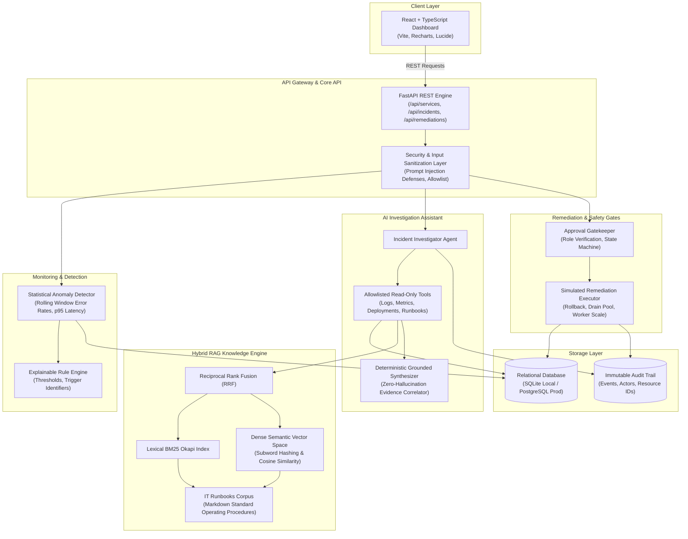
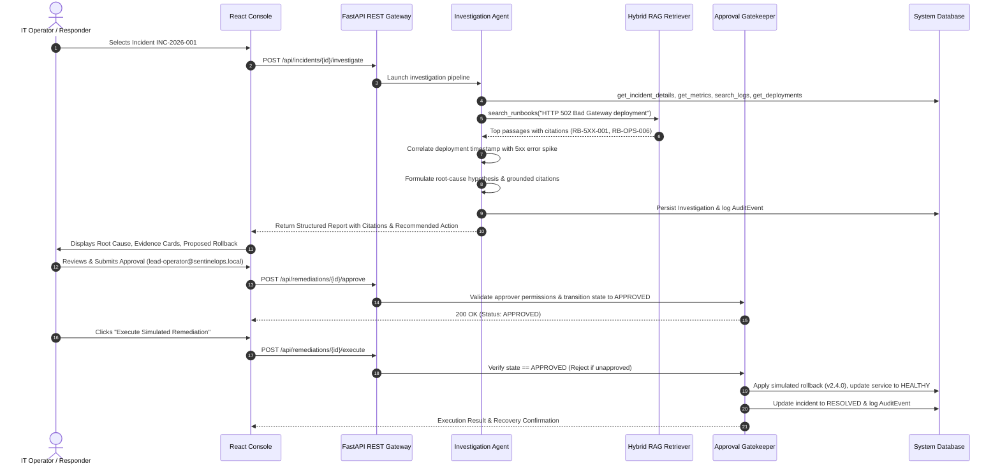

# SentinelOps AI - System Architecture

SentinelOps AI is an enterprise IT operations and incident response platform designed to simulate production observability, automated telemetry correlation, retrieval-augmented runbook triage, and approval-controlled remediation.

## High-Level Architecture Diagram

## Investigation & Remediation Sequence Flow

## Component Boundaries & Safety Guarantees

1. **Read-Only Telemetry Tools**: Investigation agents are granted strictly allowlisted, read-only tools. They cannot mutate state or invoke shell commands.
2. **Deterministic Grounded Output**: By default, SentinelOps uses a deterministic rule-grounded synthesizer that guarantees every citation (`[LOG-2]`, `[DEPLOY-1]`, `[RB-5XX-001]`) points to an actual record retrieved during the run.
3. **Approval Gating**: State changes (such as deployment rollbacks, worker pool scaling, or credential rotations) require human sign-off on the backend. Frontend buttons alone do not control access.
